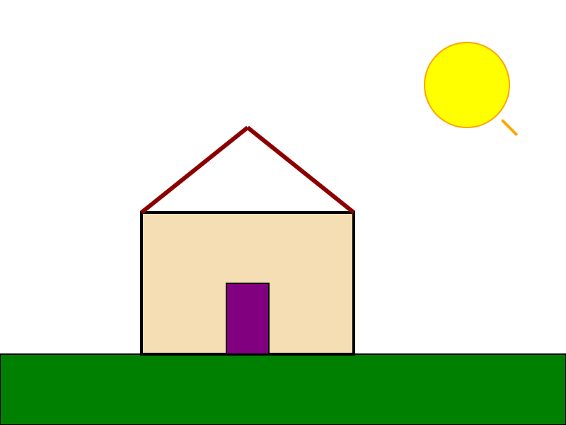
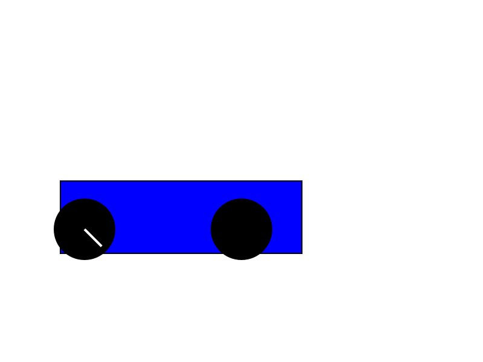
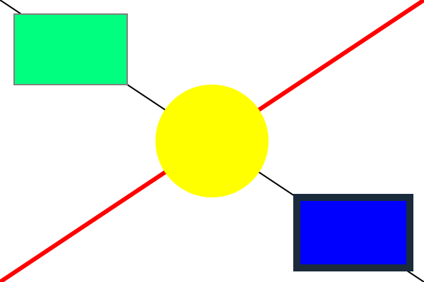
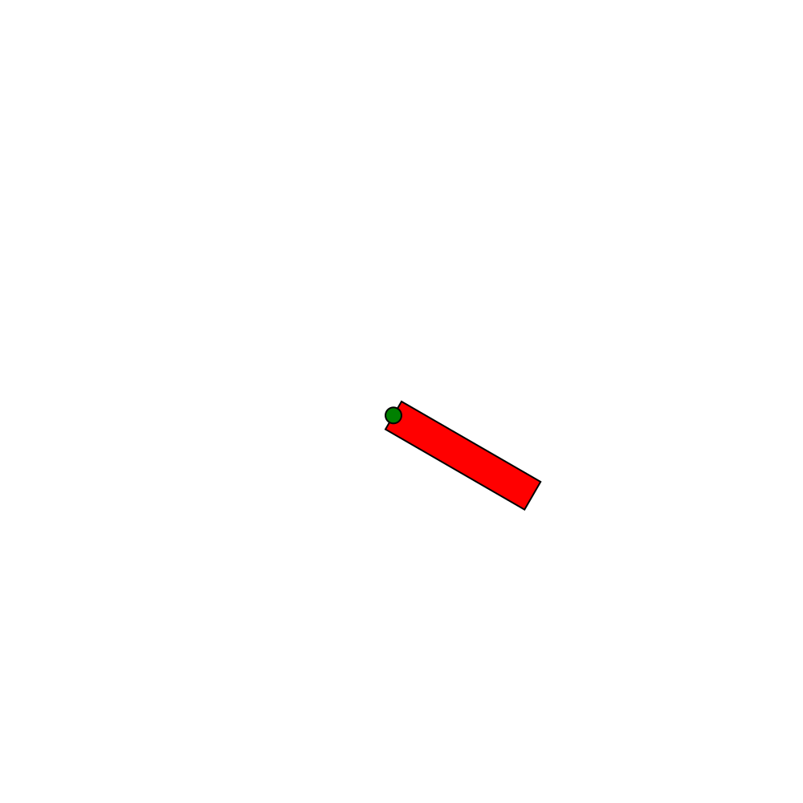
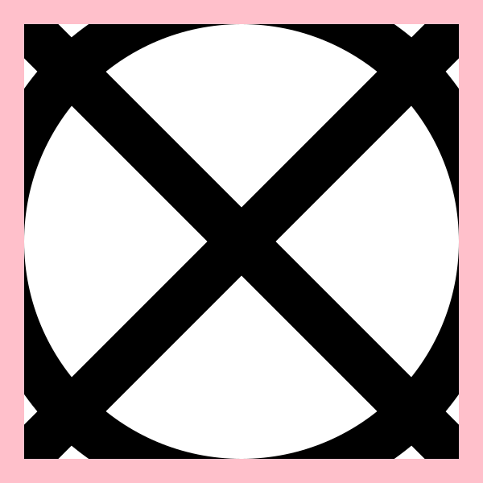
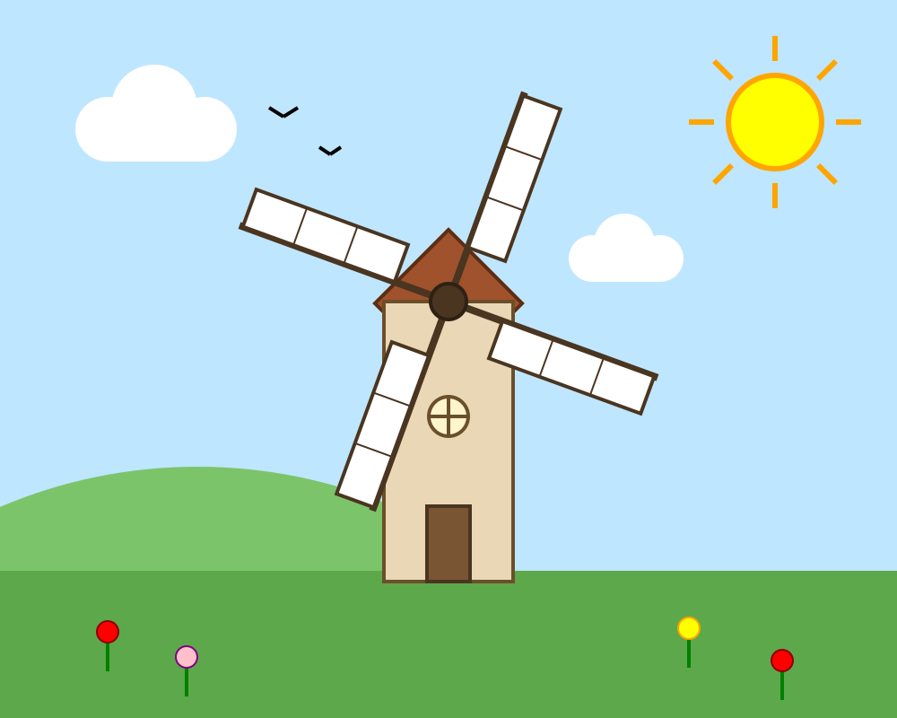

# Testes da Fase 2

Linguagem de Desenho, Fase 2 (da AST ao SVG). Este documento reúne os entregáveis 5.4 e 5.5:

- o **arquivo `.svg` e a imagem** de cada um dos 5 programas válidos da Fase 1 (V1 a V5);
- **3 programas com erro semântico** (S1 a S3), um para cada verificação, com as mensagens que a página mostra;
- o **desenho final** (F1): o programa, o `.svg` e a imagem.

Os arquivos ficam na pasta [`saidas/`](../saidas/). Os programas são os mesmos de `casos.js`. Para conferir:

- **Na página**: escolha o caso na lista "Carregar caso de teste". O SVG gerado aparece na coluna da direita, já desenhado, e a página diz se o resultado confere com o esperado.
- **No terminal**: `node testes.js` roda todos os casos e confere que os `.svg` da pasta `saidas/` são iguais aos que o compilador gera. `node gerar-saidas.js` grava de novo os `.svg`, os `.png` e o programa do desenho final.

## Resumo

| Caso | Nome | Resultado | Arquivos |
|---|---|---|---|
| V1 | Casa com sol | SVG gerado | [.svg](../saidas/V1-casa-com-sol.svg) · [.png](../saidas/V1-casa-com-sol.png) |
| V2 | Carro | SVG gerado | [.svg](../saidas/V2-carro.svg) · [.png](../saidas/V2-carro.png) |
| V3 | Formas e estilos | SVG gerado | [.svg](../saidas/V3-formas-e-estilos.svg) · [.png](../saidas/V3-formas-e-estilos.png) |
| V4 | Grupos e modificadores | SVG gerado | [.svg](../saidas/V4-grupos-e-modificadores.svg) · [.png](../saidas/V4-grupos-e-modificadores.png) |
| V5 | Formato livre | SVG gerado | [.svg](../saidas/V5-formato-livre.svg) · [.png](../saidas/V5-formato-livre.png) |
| S1 | Tela sem altura | 1 erro semântico (linha 2); sem SVG | |
| S2 | Círculo de raio zero | 1 erro semântico (linha 7); sem SVG | |
| S3 | Retângulos sem tamanho | 3 erros semânticos (linhas 2, 5, 6); sem SVG | |
| F1 | Desenho final: moinho de vento | SVG gerado | [.txt](../saidas/F1-moinho-de-vento.txt) · [.svg](../saidas/F1-moinho-de-vento.svg) · [.png](../saidas/F1-moinho-de-vento.png) |

## Programas válidos

Para cada programa: o código, o SVG gerado (o conteúdo do arquivo `.svg`) e a imagem desse SVG (o `.png`, gerado com fundo branco e ampliado pelo `rsvg-convert`).

### V1: Casa com sol

Comentário antes da tela e no fim das linhas, as três formas, cores por nome e hexadecimais, os três atributos e um grupo dentro de outro.

**Programa**

```
// Uma casa com sol
tela(400, 300)
retangulo(0, 250, 400, 50) preenchimento: verde              // gramado
retangulo(100, 150, 150, 100) preenchimento: #F5DEB3 traco: preto espessura: 2
reta(100, 150, 175, 90) traco: #8B0000 espessura: 3          // telhado
reta(175, 90, 250, 150) traco: #8B0000 espessura: 3
retangulo(160, 200, 30, 50) preenchimento: roxo              // porta
grupo mover(330, 60) {                                       // sol
    circulo(0, 0, 30) preenchimento: amarelo traco: laranja
    grupo girar(45) {
        reta(35, 0, 50, 0) traco: laranja espessura: 2       // um raio
    }
}
```

**SVG gerado** ([`saidas/V1-casa-com-sol.svg`](../saidas/V1-casa-com-sol.svg))

```xml
<svg xmlns="http://www.w3.org/2000/svg" width="400" height="300" viewBox="0 0 400 300">
  <rect x="0" y="250" width="400" height="50" fill="green" stroke="black" stroke-width="1"/>
  <rect x="100" y="150" width="150" height="100" fill="#F5DEB3" stroke="black" stroke-width="2"/>
  <line x1="100" y1="150" x2="175" y2="90" fill="none" stroke="#8B0000" stroke-width="3"/>
  <line x1="175" y1="90" x2="250" y2="150" fill="none" stroke="#8B0000" stroke-width="3"/>
  <rect x="160" y="200" width="30" height="50" fill="purple" stroke="black" stroke-width="1"/>
  <g transform="translate(330 60)">
    <circle cx="0" cy="0" r="30" fill="yellow" stroke="orange" stroke-width="1"/>
    <g transform="rotate(45)">
      <line x1="35" y1="0" x2="50" y2="0" fill="none" stroke="orange" stroke-width="2"/>
    </g>
  </g>
</svg>
```

**Imagem** ([`saidas/V1-casa-com-sol.png`](../saidas/V1-casa-com-sol.png))



### V2: Carro

O exemplo do enunciado escrito nesta linguagem: dois grupos deslocados (rodas), o primeiro com um grupo girado dentro.

**Programa**

```
tela(400, 300)
// um carro simples
retangulo(50, 150, 200, 60) preenchimento: azul
grupo mover(70, 190) {
    circulo(0, 0, 25) preenchimento: preto
    grupo girar(45) {
        reta(0, 0, 20, 0) traco: branco espessura: 2
    }
}
grupo mover(200, 190) {
    circulo(0, 0, 25) preenchimento: preto
}
```

**SVG gerado** ([`saidas/V2-carro.svg`](../saidas/V2-carro.svg))

```xml
<svg xmlns="http://www.w3.org/2000/svg" width="400" height="300" viewBox="0 0 400 300">
  <rect x="50" y="150" width="200" height="60" fill="blue" stroke="black" stroke-width="1"/>
  <g transform="translate(70 190)">
    <circle cx="0" cy="0" r="25" fill="black" stroke="black" stroke-width="1"/>
    <g transform="rotate(45)">
      <line x1="0" y1="0" x2="20" y2="0" fill="none" stroke="white" stroke-width="2"/>
    </g>
  </g>
  <g transform="translate(200 190)">
    <circle cx="0" cy="0" r="25" fill="black" stroke="black" stroke-width="1"/>
  </g>
</svg>
```

**Imagem** ([`saidas/V2-carro.png`](../saidas/V2-carro.png))



### V3: Formas e estilos

Formas sem estilo, atributos em ordens diferentes, hexadecimal em maiúsculas, minúsculas e misto, e o número 0 em coordenadas e na espessura.

**Programa**

```
// as três formas, sem estilo e com estilo em ordens diferentes
tela(300, 200)
reta(0, 0, 300, 200)
reta(0, 200, 300, 0) espessura: 3 traco: #FF0000
circulo(150, 100, 40) traco: preto preenchimento: amarelo espessura: 0
retangulo(10, 10, 80, 50) preenchimento: #00ff7f traco: cinza
retangulo(210, 140, 80, 50) espessura: 5 preenchimento: azul traco: #1a2B3c
```

**SVG gerado** ([`saidas/V3-formas-e-estilos.svg`](../saidas/V3-formas-e-estilos.svg))

```xml
<svg xmlns="http://www.w3.org/2000/svg" width="300" height="200" viewBox="0 0 300 200">
  <line x1="0" y1="0" x2="300" y2="200" fill="none" stroke="black" stroke-width="1"/>
  <line x1="0" y1="200" x2="300" y2="0" fill="none" stroke="#FF0000" stroke-width="3"/>
  <circle cx="150" cy="100" r="40" fill="yellow" stroke="black" stroke-width="0"/>
  <rect x="10" y="10" width="80" height="50" fill="#00ff7f" stroke="gray" stroke-width="1"/>
  <rect x="210" y="140" width="80" height="50" fill="blue" stroke="#1a2B3c" stroke-width="5"/>
</svg>
```

**Imagem** ([`saidas/V3-formas-e-estilos.png`](../saidas/V3-formas-e-estilos.png))



### V4: Grupos e modificadores

Grupo sem modificadores, grupo vazio, três níveis de aninhamento e modificadores repetidos e misturados, que ficam na AST na ordem em que foram escritos.

**Programa**

```
// grupos aninhados, grupo vazio e modificadores na ordem escrita
tela(500, 500)
grupo {
    grupo { }
}
grupo mover(250, 250) girar(30) {
    retangulo(0, 0, 100, 20) preenchimento: vermelho
    grupo girar(90) mover(10, 0) girar(0) {
        grupo mover(0, 0) {
            circulo(0, 0, 5) preenchimento: verde
        }
    }
}
```

**SVG gerado** ([`saidas/V4-grupos-e-modificadores.svg`](../saidas/V4-grupos-e-modificadores.svg))

```xml
<svg xmlns="http://www.w3.org/2000/svg" width="500" height="500" viewBox="0 0 500 500">
  <g>
    <g/>
  </g>
  <g transform="translate(250 250) rotate(30)">
    <rect x="0" y="0" width="100" height="20" fill="red" stroke="black" stroke-width="1"/>
    <g transform="rotate(90) translate(10 0) rotate(0)">
      <g transform="translate(0 0)">
        <circle cx="0" cy="0" r="5" fill="green" stroke="black" stroke-width="1"/>
      </g>
    </g>
  </g>
</svg>
```

**Imagem** ([`saidas/V4-grupos-e-modificadores.png`](../saidas/V4-grupos-e-modificadores.png))



### V5: Formato livre

Espaços são opcionais entre tokens: comandos colados na mesma linha, comentário colado no código, tabulações, linhas em branco e espaços dentro dos parênteses.

**Programa**

```
tela(10,10)// sem espaços, comentário colado
reta(0,0,10,10)reta(10,0,0,10) circulo(5,5,5)
		retangulo  (  0 ,  0 , 10 , 10  )   traco:rosa


grupo{}grupo girar(0){reta(0,0,0,0)traco:branco}
```

**SVG gerado** ([`saidas/V5-formato-livre.svg`](../saidas/V5-formato-livre.svg))

```xml
<svg xmlns="http://www.w3.org/2000/svg" width="10" height="10" viewBox="0 0 10 10">
  <line x1="0" y1="0" x2="10" y2="10" fill="none" stroke="black" stroke-width="1"/>
  <line x1="10" y1="0" x2="0" y2="10" fill="none" stroke="black" stroke-width="1"/>
  <circle cx="5" cy="5" r="5" fill="none" stroke="black" stroke-width="1"/>
  <rect x="0" y="0" width="10" height="10" fill="none" stroke="pink" stroke-width="1"/>
  <g/>
  <g transform="rotate(0)">
    <line x1="0" y1="0" x2="0" y2="0" fill="none" stroke="white" stroke-width="1"/>
  </g>
</svg>
```

**Imagem** ([`saidas/V5-formato-livre.png`](../saidas/V5-formato-livre.png))



## Programas com erro semântico

Os três passam pelo léxico e pelo parser, porque a gramática aceita o zero, mas a verificação semântica os rejeita. A página mostra as fases (léxico ✓, sintático ✓, semântico ✗, gerador não executado), a quantidade de erros, uma tabela com a linha e a mensagem de cada erro e marca as linhas no editor. Nenhum SVG é gerado: a caixa de SVG e a imagem ficam vazias, com o aviso "Nenhum SVG gerado: corrija os erros do programa."

### S1: Tela sem altura

A tela tem altura 0. O programa passa pelo léxico e pelo parser (a gramática aceita o zero), mas a verificação semântica o rejeita e o SVG não é gerado.

**Programa**

```
 1  // um sol numa tela sem altura
 2  tela(400, 0)
 3  grupo mover(200, 150) {
 4      circulo(0, 0, 50) preenchimento: amarelo traco: laranja
 5  }
```

**O que a página mostra**: 1 erro semântico. "A AST foi gerada, mas o programa não faz sentido: o SVG não foi gerado."

| Linha | Mensagem |
|---|---|
| 2 | a tela precisa ter largura e altura maiores que zero, mas a altura é 0 |

### S2: Círculo de raio zero

Um círculo de raio 0 dentro de três grupos aninhados. A verificação percorre a AST inteira e acha o erro lá dentro, com a linha do círculo.

**Programa**

```
 1  tela(300, 200)
 2  // a roda pequena não tem raio
 3  grupo mover(150, 100) {
 4      circulo(0, 0, 40) preenchimento: cinza
 5      grupo girar(45) {
 6          grupo mover(60, 0) {
 7              circulo(0, 0, 0) preenchimento: preto
 8          }
 9      }
10  }
```

**O que a página mostra**: 1 erro semântico. "A AST foi gerada, mas o programa não faz sentido: o SVG não foi gerado."

| Linha | Mensagem |
|---|---|
| 7 | o círculo precisa ter raio maior que zero |

### S3: Retângulos sem tamanho

Três retângulos com largura ou altura 0, um fora e dois dentro de um grupo. A verificação relata todos os erros de uma vez, na ordem do programa.

**Programa**

```
 1  tela(300, 200)
 2  retangulo(10, 10, 0, 50) preenchimento: azul
 3  circulo(150, 100, 30)
 4  grupo mover(100, 100) {
 5      retangulo(0, 0, 80, 0) traco: vermelho
 6      retangulo(0, 20, 0, 0)
 7  }
```

**O que a página mostra**: 3 erros semânticos. "A AST foi gerada, mas o programa não faz sentido: o SVG não foi gerado."

| Linha | Mensagem |
|---|---|
| 2 | o retângulo precisa ter largura e altura maiores que zero, mas a largura é 0 |
| 5 | o retângulo precisa ter largura e altura maiores que zero, mas a altura é 0 |
| 6 | o retângulo precisa ter largura e altura maiores que zero, mas a largura e a altura são 0 |

(Os números à esquerda dos programas acima são só as linhas do editor; não fazem parte do programa.)

## Desenho final: moinho de vento

Desenho final: um moinho num campo, com sol, nuvens, pássaros e flores. A hélice é um grupo deslocado e girado com quatro pás, cada uma num grupo girado; o telhado é um quadrado girado 45 graus, com a metade de baixo escondida atrás da torre.



| Arquivo | Conteúdo |
|---|---|
| [`saidas/F1-moinho-de-vento.txt`](../saidas/F1-moinho-de-vento.txt) | O programa na linguagem (também na página: caso F1). |
| [`saidas/F1-moinho-de-vento.svg`](../saidas/F1-moinho-de-vento.svg) | O SVG gerado. |
| [`saidas/F1-moinho-de-vento.png`](../saidas/F1-moinho-de-vento.png) | A imagem acima. |

O que o desenho usa:

- **As três formas**: retângulos (céu, chão, torre, porta, pás e telhado), círculos (colina, sol, nuvens, janela, eixo da hélice e flores) e retas (raios do sol, varas das pás, pássaros, cruz da janela e caules).
- **Grupos aninhados com os dois modificadores**: a hélice é um grupo com `mover(250, 168) girar(20)` e, dentro dele, cada uma das quatro pás é um grupo com `girar(0)`, `girar(90)`, `girar(180)` ou `girar(270)`. O sol é um grupo com `mover` e, dentro dele, oito grupos com `girar`, um para cada raio. Cada pá e cada raio são desenhados em coordenadas locais, a partir de (0, 0), e os grupos os posicionam.
- **Ordem dos modificadores**: no telhado, `grupo mover(250, 128) girar(45)` primeiro leva a origem para a ponta do telhado, (250, 128), e depois gira o quadrado em torno dela, formando um losango com a ponta para cima. Na ordem inversa, `girar(45) mover(250, 128)`, o deslocamento seria feito já na direção girada e o telhado sairia do lugar.
- **Ordem dos elementos**: a torre vem depois do telhado e cobre a metade de baixo do losango, que fica parecendo um triângulo. As pás vêm depois da torre e ficam por cima dela.
- **Espessura 0** no céu, no chão, na colina e nas nuvens, para que não tenham contorno.

<details>
<summary>Programa completo</summary>

```
// Desenho final: um moinho de vento num campo
tela(500, 400)

// céu, colina e chão (espessura 0: sem contorno)
retangulo(0, 0, 500, 400) preenchimento: #BFE6FF espessura: 0
circulo(110, 540, 280) preenchimento: #7CC46A espessura: 0
retangulo(0, 318, 500, 82) preenchimento: #5DA84B espessura: 0

// sol: um círculo e oito raios, cada raio num grupo girado
grupo mover(432, 68) {
    circulo(0, 0, 26) preenchimento: amarelo traco: laranja espessura: 3
    grupo girar(0)   { reta(34, 0, 48, 0) traco: laranja espessura: 3 }
    grupo girar(45)  { reta(34, 0, 48, 0) traco: laranja espessura: 3 }
    grupo girar(90)  { reta(34, 0, 48, 0) traco: laranja espessura: 3 }
    grupo girar(135) { reta(34, 0, 48, 0) traco: laranja espessura: 3 }
    grupo girar(180) { reta(34, 0, 48, 0) traco: laranja espessura: 3 }
    grupo girar(225) { reta(34, 0, 48, 0) traco: laranja espessura: 3 }
    grupo girar(270) { reta(34, 0, 48, 0) traco: laranja espessura: 3 }
    grupo girar(315) { reta(34, 0, 48, 0) traco: laranja espessura: 3 }
}

// nuvens: três círculos e um retângulo que deixa a base reta
grupo mover(60, 52) {
    circulo(0, 20, 18) preenchimento: branco espessura: 0
    circulo(26, 8, 24) preenchimento: branco espessura: 0
    circulo(54, 20, 18) preenchimento: branco espessura: 0
    retangulo(0, 20, 54, 18) preenchimento: branco espessura: 0
}
grupo mover(330, 130) {
    circulo(0, 14, 13) preenchimento: branco espessura: 0
    circulo(18, 6, 17) preenchimento: branco espessura: 0
    circulo(38, 14, 13) preenchimento: branco espessura: 0
    retangulo(0, 14, 38, 13) preenchimento: branco espessura: 0
}

// pássaros: duas retas em V
grupo mover(150, 60) {
    reta(0, 0, 8, 5) espessura: 2
    reta(8, 5, 16, 0) espessura: 2
}
grupo mover(178, 82) {
    reta(0, 0, 6, 4) espessura: 2
    reta(6, 4, 12, 0) espessura: 2
}

// moinho: o telhado é um quadrado girado 45 graus; a torre, desenhada depois, cobre a metade de baixo
grupo mover(250, 128) girar(45) {
    retangulo(0, 0, 58, 58) preenchimento: #A0522D traco: #5C2E12 espessura: 2
}
retangulo(214, 168, 72, 156) preenchimento: #EAD7B5 traco: #6B4F2A espessura: 2
retangulo(238, 282, 24, 42) preenchimento: #7A5533 traco: #4A3520 espessura: 2
circulo(250, 232, 11) preenchimento: #FFF5CC traco: #6B4F2A espessura: 2
reta(239, 232, 261, 232) traco: #6B4F2A espessura: 2
reta(250, 221, 250, 243) traco: #6B4F2A espessura: 2

// hélice: quatro pás iguais, cada uma num grupo girado dentro do grupo da hélice
grupo mover(250, 168) girar(20) {
    grupo girar(0) {
        reta(0, 0, 124, 0) traco: #4A3520 espessura: 4
        retangulo(32, 0, 90, 22) preenchimento: branco traco: #4A3520 espessura: 2
        reta(62, 0, 62, 22) traco: #4A3520
        reta(92, 0, 92, 22) traco: #4A3520
    }
    grupo girar(90) {
        reta(0, 0, 124, 0) traco: #4A3520 espessura: 4
        retangulo(32, 0, 90, 22) preenchimento: branco traco: #4A3520 espessura: 2
        reta(62, 0, 62, 22) traco: #4A3520
        reta(92, 0, 92, 22) traco: #4A3520
    }
    grupo girar(180) {
        reta(0, 0, 124, 0) traco: #4A3520 espessura: 4
        retangulo(32, 0, 90, 22) preenchimento: branco traco: #4A3520 espessura: 2
        reta(62, 0, 62, 22) traco: #4A3520
        reta(92, 0, 92, 22) traco: #4A3520
    }
    grupo girar(270) {
        reta(0, 0, 124, 0) traco: #4A3520 espessura: 4
        retangulo(32, 0, 90, 22) preenchimento: branco traco: #4A3520 espessura: 2
        reta(62, 0, 62, 22) traco: #4A3520
        reta(92, 0, 92, 22) traco: #4A3520
    }
    circulo(0, 0, 10) preenchimento: #4A3520 traco: #2E2114 espessura: 2
}

// flores: um caule e uma flor, cada flor num grupo deslocado
grupo mover(60, 352) {
    reta(0, 0, 0, 22) traco: verde espessura: 2
    circulo(0, 0, 6) preenchimento: vermelho traco: #8B0000
}
grupo mover(104, 366) {
    reta(0, 0, 0, 22) traco: verde espessura: 2
    circulo(0, 0, 6) preenchimento: rosa traco: roxo
}
grupo mover(384, 350) {
    reta(0, 0, 0, 22) traco: verde espessura: 2
    circulo(0, 0, 6) preenchimento: amarelo traco: laranja
}
grupo mover(436, 368) {
    reta(0, 0, 0, 22) traco: verde espessura: 2
    circulo(0, 0, 6) preenchimento: vermelho traco: #8B0000
}
```

</details>
